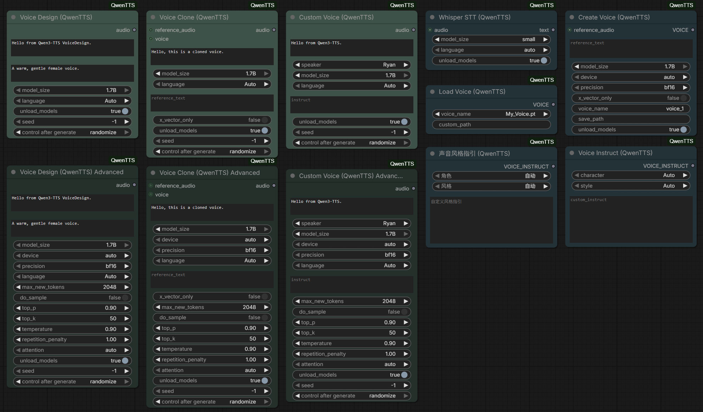

# Qwen3-TTS para ComfyUI — versão FrancosCorp

**Custom nodes de Qwen3-TTS (12Hz) para ComfyUI**: CustomVoice, VoiceDesign e VoiceClone, com otimizações de VRAM para AMD ROCm e estabilidade em FP32.

Este repositório é uma extensão do ComfyUI e não inclui uma imagem Docker ou um servidor
independente. Instale-o em `ComfyUI/custom_nodes/meu-qwen3-tts` e siga os passos abaixo.

[](https://www.python.org/)
[](https://github.com/comfyanonymous/ComfyUI)
[](LICENSE)
[](#)



---

## Sobre

Pacote de nós customizados que integra os modelos **Qwen3-TTS** ao ComfyUI, cobrindo três fluxos de trabalho de fala sintética: voz predefinida (**CustomVoice**), criação de voz por descrição em linguagem natural (**VoiceDesign**) e clonagem de voz (**VoiceClone**). É voltado para quem já usa ComfyUI e quer gerar áudio falado de alta qualidade sem montar pipelines de inferência à mão.

Esta é uma **versão derivada e otimizada** do projeto [ComfyUI-QwenTTS](https://github.com/1038lab/ComfyUI-QwenTTS) (autor original: 1038lab), mantida por **Rodolfo Franco (FrancosCorporation)**. As alterações próprias estão nos commits de "Versão Rodolfo Master", otimização de memória para AMD ROCm e estabilização de FP32 (ver `Update.md`).

## Funcionalidades

Comprovado pelo código (`nodes.py`, `AILab_QwenTTS_Tools.py`, `AILab_AudioDuration.py`):

- **Custom Voice** (básico e avançado): TTS com timbres predefinidos.
- **Voice Design** (básico e avançado): criação de vozes descritas em texto.
- **Voice Clone** (básico e avançado): clonagem a partir de áudio de referência + transcrição, com suporte opcional a entrada `VOICE` salva.
- **Create Voice / Load Voice**: cria e recarrega perfis de voz (`.pt`) na biblioteca de vozes.
- **Whisper STT**: transcrição de `AUDIO` para texto.
- **Voice Instruct (EN) / 声音风格指引 (ZH)**: presets de instrução de estilo, lidos de `voice_instruct.json` e `voice_instruct_zh.json`.
- **Audio Duration & Frames**: duração em segundos (`int`/`float`), cálculo de frames por `fps` e caminho do áudio.
- **Seleção de backend de atenção**: `auto / sage_attn / flash_attn / sdpa / eager`.
- **Multi-dispositivo**: seleção automática CUDA → MPS → CPU.
- **Download automático de modelos** do Hugging Face para `ComfyUI/models/TTS/Qwen3-TTS/<MODELO>/`.
- **Revisões e SHA-256 fixos** para os cinco repositórios aprovados. A primeira verificação local
  lê os arquivos de peso completos e pode levar alguns minutos.
- **Workflows de exemplo** em `example_workflows/` (CustomVoice, VoiceDesign, VoiceClone, Create Voice e integração com QwenASR).

### Diferenciais FrancosCorp

- Otimizado para **AMD ROCm 6.4**.
- **Gestão agressiva de VRAM** (`soft_empty_cache`, `torch.cuda.empty_cache`, `synchronize`) para evitar crashes em FP32.
- **Sincronização de tensores** injetada nos pontos de descarga para maior estabilidade.

## Stack

- **Python 3.10+** (o pacote vendorizado `qwen_tts/` também tem artefatos compilados para 3.12).
- **PyTorch / Torchaudio** (`2.9.x`), **Transformers** (`4.57.x`), **Accelerate**, **sentencepiece**, **tiktoken**.
- **librosa**, **soundfile**, **numpy**, **einops**, **openai-whisper**, **huggingface_hub**, **safetensors**.
- Runtime do **ComfyUI** (`folder_paths`, `comfy.model_management`).
- JavaScript (1 arquivo de aparência em `web/js/appearance.js`).

Dependências declaradas com faixas compatíveis em `requirements.txt` e `pyproject.toml`. Os dois
arquivos usam as mesmas versões mínimas e máximas.

## Como rodar

Este projeto é um **custom node**: ele só funciona dentro de uma instalação do ComfyUI.

1) Coloque o repositório em `ComfyUI/custom_nodes/` (via ComfyUI-Manager ou `git clone`):

```bash
cd ComfyUI/custom_nodes
git clone https://github.com/FrancosCorporation/meu-qwen3-tts.git
```

2) Instale as dependências com o Python do ComfyUI:

```bash
python -m pip install -r ComfyUI/custom_nodes/meu-qwen3-tts/requirements.txt --no-cache-dir
```

Instale primeiro a versão de PyTorch/Torchaudio adequada ao dispositivo (CUDA ou ROCm) recomendada
pela sua instalação do ComfyUI. Este pacote aceita a linha 2.9.x para ambos.

3) Importe um dos workflows de `example_workflows/` (ex.: `QwenTTS_sample_workflow.json`) e execute uma vez — o primeiro uso baixa os modelos e faz o warm-up.

Os cinco repositórios aprovados são baixados automaticamente na primeira execução. Cada revisão
inclui o tokenizer de fala em `speech_tokenizer/`; não é necessário baixá-lo separadamente. Os pesos
de cada repositório usam Apache-2.0. Os tamanhos abaixo são aproximados; deixe pelo menos 3,3 GB
livres para os modelos 0.6B e 5,6 GB para os modelos 1.7B para incluir a margem de download e
verificação.

| Modelo | Download | Livre recomendado | Revisão imutável |
|---|---:|---:|---|
| [Base 0.6B](https://huggingface.co/Qwen/Qwen3-TTS-12Hz-0.6B-Base) | 2,5 GB | 3,3 GB | [5d839924](https://huggingface.co/Qwen/Qwen3-TTS-12Hz-0.6B-Base/tree/5d83992436eae1d760afd27aff78a71d676296fc) |
| [CustomVoice 0.6B](https://huggingface.co/Qwen/Qwen3-TTS-12Hz-0.6B-CustomVoice) | 2,5 GB | 3,3 GB | [85e237c1](https://huggingface.co/Qwen/Qwen3-TTS-12Hz-0.6B-CustomVoice/tree/85e237c12c027371202489a0ec509ded67b5e4b5) |
| [Base 1.7B](https://huggingface.co/Qwen/Qwen3-TTS-12Hz-1.7B-Base) | 4,6 GB | 5,6 GB | [fd4b2543](https://huggingface.co/Qwen/Qwen3-TTS-12Hz-1.7B-Base/tree/fd4b254389122332181a7c3db7f27e918eec64e3) |
| [CustomVoice 1.7B](https://huggingface.co/Qwen/Qwen3-TTS-12Hz-1.7B-CustomVoice) | 4,6 GB | 5,6 GB | [0c0e3051](https://huggingface.co/Qwen/Qwen3-TTS-12Hz-1.7B-CustomVoice/tree/0c0e3051f131929182e2c023b9537f8b1c68adfe) |
| [VoiceDesign 1.7B](https://huggingface.co/Qwen/Qwen3-TTS-12Hz-1.7B-VoiceDesign) | 4,6 GB | 5,6 GB | [5ecdb673](https://huggingface.co/Qwen/Qwen3-TTS-12Hz-1.7B-VoiceDesign/tree/5ecdb67327fd37bb2e042aab12ff7391903235d3) |

O arquivo [`model_checksums.json`](model_checksums.json) registra as revisões, tamanhos e SHA-256
dos pesos principais. Pesos locais são conferidos antes do carregamento; para atualizar uma
revisão, revise o modelo e a licença e altere em conjunto os metadados e checksums.

Para pré-baixar manualmente, use `hf download` com a revisão completa do modelo, por exemplo:

```bash
hf download Qwen/Qwen3-TTS-12Hz-1.7B-CustomVoice \
  --revision 0c0e3051f131929182e2c023b9537f8b1c68adfe \
  --local-dir ComfyUI/models/TTS/Qwen3-TTS/Qwen3-TTS-12Hz-1.7B-CustomVoice
```

Caminhos alternativos podem ser configurados em `extra_model_paths.yaml` do ComfyUI (chave `tts`).
O plugin recusa pesos locais cuja revisão, tamanho ou SHA-256 não corresponda ao manifesto.

### Vozes de referência

Perfis de voz ficam em `<pasta de saída do ComfyUI>/qwen3-tts_voices`. O campo `save_path` aceita
subpastas dentro dessa biblioteca. Arquivos `.pt`, `.pth` ou `.safetensors` fora dela são recusados;
os arquivos têm limite de 200 MiB. Quando `safetensors` está instalado, o nó salva nesse formato;
perfis `.pt` antigos são lidos somente com `weights_only=True`.

Áudio de referência aceita sample rate de 8 kHz a 192 kHz, até 30 segundos e um item de áudio por
vez. O cache mantém no máximo dois modelos; a opção `unload_models` libera os modelos após a geração.

## Solução de problemas

- `'Qwen3TTSTalkerConfig' object has no attribute 'pad_token_id'` → versão incompatível de `transformers`. Corrija com:
  `pip install "transformers>=4.57.3,<5.0" --no-cache-dir` e reinstale as dependências deste projeto.
- **Áudio longo demais / zumbido no final** → reduza `max_new_tokens` (512–1024 para textos curtos) e use `do_sample=False`.
- **CUDA OOM** → divida textos longos em partes, reduza `max_new_tokens` e use `precision=bf16`.
- **Mesma seed gera áudio diferente** → a seed inicializa os geradores de PyTorch e NumPy. Ela não garante bytes idênticos entre dispositivos, versões de bibliotecas, backends de atenção ou kernels não determinísticos.

## Estrutura do projeto

```
meu-qwen3-tts/
├── __init__.py                  # expõe NODE_CLASS_MAPPINGS ao ComfyUI
├── nodes.py                     # nós principais (CustomVoice/VoiceDesign/VoiceClone)
├── AILab_QwenTTS_Tools.py       # Create/Load Voice, Whisper STT, presets de instrução
├── AILab_AudioDuration.py       # nó de duração/frames
├── qwen_tts/                    # pacote de inferência vendorizado (core, tokenizers, inference)
├── example_workflows/           # workflows .json + imagens de exemplo
├── web/js/                      # ajustes visuais dos nós
├── voice_instruct*.json         # presets de estilo (EN/ZH)
├── voice_storage.py             # validação e serialização segura de perfis de voz
├── model_checksums.json         # revisões imutáveis e SHA-256 oficiais
├── requirements.txt / pyproject.toml
├── scripts/check_supply_chain.py
├── .github/workflows/ci.yml
├── SECURITY.md
└── Update.md / README.md / LICENSE
```

## Licença

Código de integração sob **GPL-3.0** (ver [`LICENSE`](LICENSE)). Os cinco modelos Qwen3-TTS da
tabela estão identificados pelo Hugging Face como **Apache-2.0**; consulte o modelo e a revisão
antes de uso ou redistribuição. O código de integração e os pesos têm licenças diferentes.

## Créditos

- **Qwen3-TTS** — Alibaba Qwen Team.
- **[ComfyUI-QwenTTS](https://github.com/1038lab/ComfyUI-QwenTTS)** — projeto original de 1038lab, base desta versão.
- Comunidade ComfyUI.
